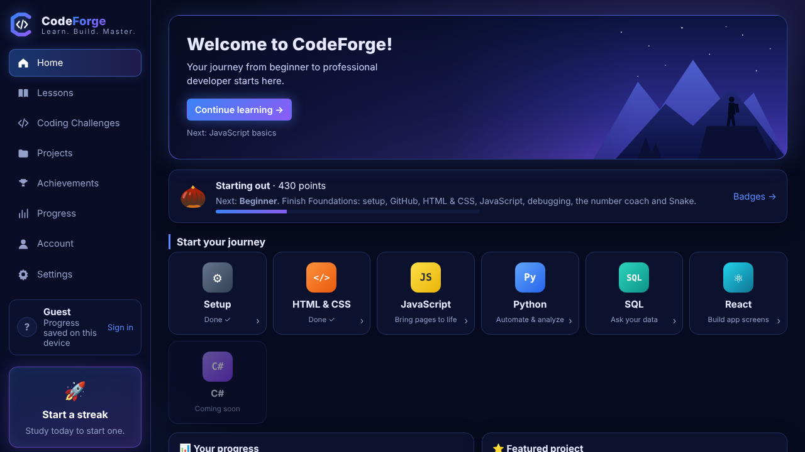
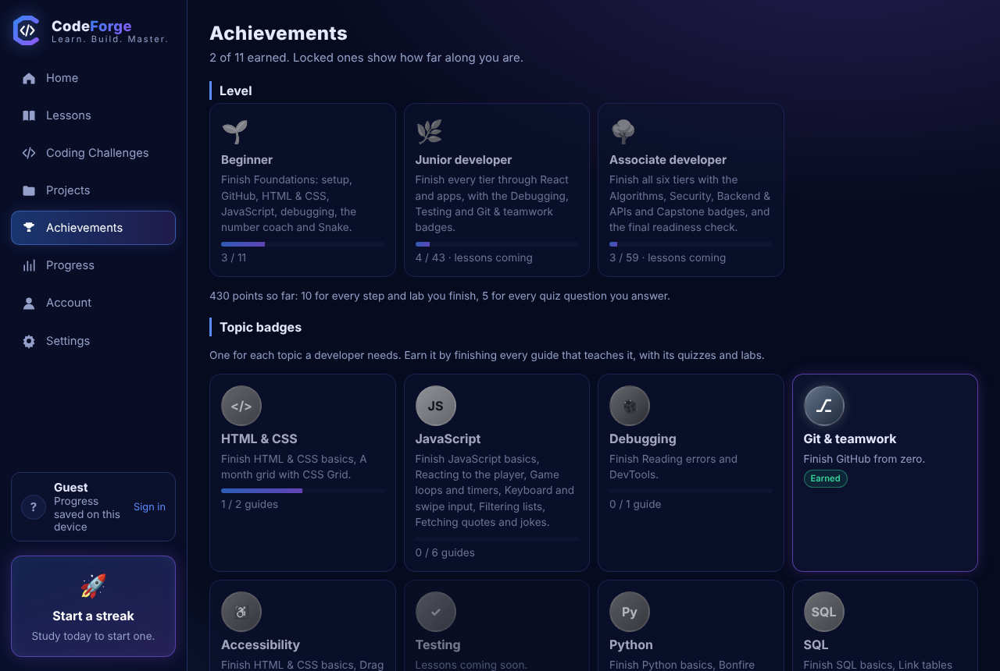
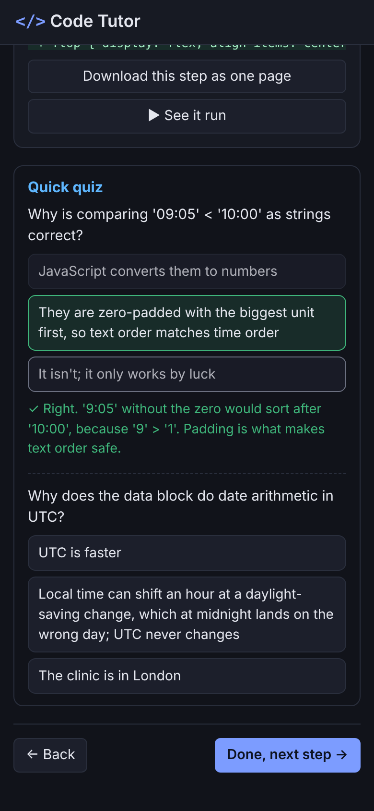

# CodeForge

**▶ [Open CodeForge](https://theoyanvno.github.io/CodeForge/)** · **[Start from zero: Get set up](https://theoyanvno.github.io/CodeForge/?guide=setup)**

Step-by-step guides that take you from installing your first code editor to building my portfolio projects from a blank page. Pick a project and follow its lesson plan: each step explains one idea with diagrams and tables, shows exactly which lines of code the step adds and why, lets you see the finished step run, and ends with a short quiz. A pace timer keeps you on schedule, and your progress is saved in the browser.

It's a learning guide, not a code playground: you build your own copy in your own editor (VS Code, for example), typing each step's changes yourself. Fell behind? Copy a whole file, or download the step as one page.

**Tech:** vanilla JavaScript (ES modules) · HTML/CSS (Orbitron and Segoe UI, dark-first) · a small safe Markdown renderer · LCS line diffs · sandboxed `<iframe srcdoc>` for the read-only results · `localStorage` · `node:test`







## The guides

Take them in order: the course runs from beginner to advanced in six tiers. Each **basics** guide builds a small project of its own, each short **lesson** teaches one idea with its own example, and each **project** combines the lessons right before it, so every step is something you've already practiced ("You learned this in…" links back). A project's plan page lists the lessons it needs, with a tick for each one you've finished.

Every Foundations project ends with three **practice labs** that build a developer's daily habits: **Find the bug**, **Review this change** (the reviewer's side of a pull request) and **Build it yourself** (a spec and a blank page).

### Tier 1: Foundations

Your tools, GitHub, your first page, JavaScript, reading errors, and your first game.

| Guide | Steps | What you learn |
|---|---|---|
| 🧰 Get set up | 9 in 3 sessions · about 2 hours · 9 quiz questions | What to install and why: VS Code and the best extensions, browser developer tools, Git and GitHub, Node.js and Python, then publishing a first page |
| 🐙 GitHub from zero | 13 in 5 sessions · about 3.5 hours · 18 quiz questions | Everything from making an account to pushing commits: 2FA, a profile README, repositories, the commit cycle, signing in, branches and pull requests, fixing mistakes and GitHub Pages, building a learning log, then team Git: issues, reviewing pull requests, merge conflicts and GitHub Actions CI |
| 🎨 HTML & CSS basics | 14 in 5 sessions · about 3.5 hours · 25 quiz questions | Elements, semantic structure, selectors, the box model, Flexbox and media queries, accessibility (alt text, a skip link, focus rings, contrast), building a profile page, then three practice labs |
| 🧮 JavaScript basics | 11 in 4 sessions · about 3 hours · 18 quiz questions | Variables, functions, events, if/else, arrays and loops, building a tip calculator, then three practice labs |
| 📘 Lessons | 1 | 🐞 Reading errors and DevTools |
| 🎯 Reacting to the player | 10 in 4 sessions · about 3 hours · 17 quiz questions | The input, evaluate, respond loop, game state, and grading moves against the best move, building a guessing game with a coach, then three practice labs |
| 📘 Lessons | 4 | 🖌️ Canvas drawing · ⏱️ Game loops and timers · 🎮 Keyboard and swipe input · 💾 Saving a best score |
| 🐍 [Snake](https://github.com/TheoYanvno/snake-game) | 17 in 5 sessions · about 4.5 hours · 32 quiz questions | Canvas drawing, a game loop, keyboard and swipe controls, keeping rules separate from drawing, the Two by Two (Noah's ark) theme with verses linked to SuperBook, then three practice labs |

### Tier 2: Working with data in the browser

Fetching from APIs, saving data, dates, dragging, accounts and a desktop app.

| Guide | Steps | What you learn |
|---|---|---|
| 🌤️ Web APIs | 7 in 3 sessions · about 2 hours · 13 quiz questions | Request URLs, fetch with async and await, res.ok, JSON, and loading and error states, building a weather app |
| 🖥️ Electron basics | 7 in 3 sessions · about 2 hours · 8 quiz questions | Main and renderer processes, a safe preload bridge, IPC and system notifications, building a desktop reminders app |
| 📘 Lessons | 3 | 🗂️ App state as plain objects · 🖐️ Dragging with pointer events · 🛟 Saving data safely |
| 🗒️ [Sticky Notes](https://github.com/TheoYanvno/sticky-notes) | 11 in 5 sessions · about 3 hours · 20 quiz questions | State as plain objects, a reversible checklist, keeping focus across redraws, pointer-event dragging, safe saving |
| 📘 Lessons | 5 | 🗓️ Dates and time zones in JavaScript · 🧱 A month grid with CSS Grid · 🔁 Repeating events · 🫳 Drag and drop · 📆 .ics calendar files |
| 📅 [Task Calendar](https://github.com/TheoYanvno/task-calendar) | 11 in 5 sessions · about 3 hours · 20 quiz questions | Date keys without time-zone bugs, repeat rules, holiday math, theming with custom properties, .ics and Google Calendar links |
| 📘 Lessons | 6 | 🎲 Arrays of objects and random picks · 🔎 Filtering lists · 📡 Fetching quotes and jokes · 💖 Saving favorites · 🔐 Accounts: sign up, hashed passwords and sessions · 📤 Sharing: copy, share sheet and links |
| 💬 [Quote & Joke Generator](https://github.com/TheoYanvno/quote-and-joke-generator) | 10 in 5 sessions · about 3 hours · 18 quiz questions | Random picks without repeats, a date-seeded daily pick, salted password hashing, sessions and lockouts, a REST API as one function |

### Tier 3: Python and SQL

Python, a static site generator, and databases from your first table to many-to-many searches.

| Guide | Steps | What you learn |
|---|---|---|
| 🐍 Python basics | 8 in 3 sessions · about 2 hours · 11 quiz questions | Lists, dictionaries, functions, try/except, JSON files and unittest, building a command-line budget tracker |
| 📘 Lessons | 3 | 🧩 Parsing Markdown with regular expressions · 🧭 Hash routing · ✨ Canvas particles |
| 🔥 [Bonfire Notes](https://github.com/TheoYanvno/bonfire-notes) | 10 in 5 sessions · about 3 hours · 18 quiz questions | Front matter, a safe Markdown converter, hash routing, RSS and redirects, canvas particles |
| 🗄️ SQL basics | 8 in 3 sessions · about 2 hours · 15 quiz questions | Tables, safe INSERTs, WHERE, ORDER BY, LIKE, GROUP BY and JOIN, building a book library |
| 📘 Lessons | 2 | 🔗 Link tables (many-to-many) · 🏆 Ranked search |
| 🦸 [Marvel Character Database](https://github.com/TheoYanvno/marvel-character-database) | 11 in 5 sessions · about 3 hours · 20 quiz questions | Related tables and link tables, parameterized SQL, ranked search, GROUP BY and HAVING, UNION across both sides of a relationship, SQLite in the browser |

### Tier 4: React and apps

Components, state and effects, then React apps as they are published.

| Guide | Steps | What you learn |
|---|---|---|
| ⚛️ React basics | 6 in 2 sessions · about 1.5 hours · 12 quiz questions | Components and JSX, props, state and events, lists with keys, controlled forms, useEffect for saving and fetching, building with esbuild for GitHub Pages |

### Tier 5: Algorithms

Grids, bitmasks, recursion and backtracking, then game-tree search.

| Guide | Steps | What you learn |
|---|---|---|
| 📘 Lessons | 3 | 🔲 Grids as 2D arrays · 🎚️ Bitmasks · 🌳 Recursion and backtracking |
| 🔢 [Sudoku Solver](https://github.com/TheoYanvno/sudoku-solver) | 12 in 5 sessions · about 3 hours · 22 quiz questions | Bitmasks, constraint propagation, recursion and backtracking, generating puzzles with one answer |
| 📘 Lessons | 2 | ♞ Boards and move generation · 🌲 Minimax and alpha-beta search |
| ♟️ [Chess Coach](https://github.com/TheoYanvno/chess-coach) | 13 in 5 sessions · about 3.5 hours · 24 quiz questions | Legal move generation, evaluation, negamax with alpha-beta pruning, grading moves and explaining them |

### Tier 6: Full stack and bigger systems

A server, roles and permissions, caching, several APIs at once and a hospital system.

| Guide | Steps | What you learn |
|---|---|---|
| 📘 Lessons | 3 | 🕒 Time slots and overlap checks · 🛂 Roles and permissions · 🖥️ A small Node server |
| 🏥 [Gotham Hospital System](https://github.com/TheoYanvno/gotham-hospital-system) | 10 in 5 sessions · about 4.5 hours · 17 quiz questions | A day schedule as a table, SQLite keys and CHECK constraints, booking rules and the overlap test, a partial unique index, upserts and reports, salted PBKDF2 sign-in, sessions, and 401/403 role permissions |
| 📘 Lessons | 3 | ⚡ Caching and late responses · 🎯 Matching questions to answers · ✍️ Drawing text on a canvas |
| 📖 [SuperBook](https://github.com/TheoYanvno/SuperBook) | 10 in 5 sessions · about 3 hours · 18 quiz questions | Fetching from three public APIs, caching and late responses, question matching with stemming and weighted keywords, writing on a canvas, right-to-left languages |

55 guides: 35 lessons, 10 basics guides and 10 projects. The tests check that every idea a project step uses is taught in a lesson the project lists, that the lesson comes first, and that no step anyone may have finished ever changes its number (progress is saved by guide and step).

### Coming soon

Guides are added as each project is built and published:

- ⚛️ **React projects**, each with three lessons first: **Weatherboard** (a weather dashboard with hourly and 7-day forecasts), **Shipboard** (a task board for developers), **Cashflow** (a personal finance tracker), **Pantry** (a meal planner that picks recipes by your goals, nutrition needs and allergies), **AbramsTree** (a Bible study guide built on SuperBook, with prayers, prayer times and an interactive world map of biblical events) and **TotalRecall** (spaced-repetition flashcards for programming terms from the CodeForge lessons). React basics is ready now, so you can start there.
- 🎮 **C# games**, original games built on stories from the Bible with a dark, gothic exorcist feel: **Gates of Sheol** (a roguelike through seeded catacombs), **Nehemiah's Watch** (tower defense on Jerusalem's wall), **Testimony** (a mystery where you test every spirit), **Wilderness** (survival and camp building on the Exodus) and **Legion** (a multiplayer arena against a demon horde).
- 🛡️ **Security projects:** **SentinelEDR** (Windows endpoint detection), **NetSentinel** (network intrusion detection), **LogWatch** (a mini SIEM), **VulnScope** (asset and vulnerability management), **FileShield** (file integrity and ransomware-behavior detection), **AuthGuard** (identity and access management), **CloudSentinel** (cloud security posture), **SecureCode** (static application security testing), **IncidentIQ** (incident response and SOAR) and **ThreatIntel** (threat intelligence and IOCs).

The basics guides that run in a terminal or on the desktop (Python, Electron and React) are read-along: each step shows the code to type and run on your own computer.

## The app

- **Home:** a welcome banner with your next guide, your **level and points**, the Start your journey tracks (Setup, HTML & CSS, JavaScript, Python, SQL, React, and C# coming soon), a progress ring for the basics, and a featured project.
- **Lessons** and **Projects:** every guide in course order, in six tiers from Foundations to Full stack, grouped by the project each set of lessons leads into, and the project guides on their own.
- **Coding Challenges:** the extra exercises from the end of every guide, in one place.
- **Achievements:** three **levels** (Beginner for finishing Foundations, Junior developer through the React tier with the Debugging, Testing and Git & teamwork badges, and Associate developer for all six tiers with the Algorithms, Security, Backend & APIs and Capstone badges), a **topic badge** for each topic from HTML & CSS to Security, **points** (10 per step or lab, 5 per quiz answer), and milestones for streaks, quiz answers and finished guides, each with how far along you are.
- **Progress:** your level, steps and guides finished, your quiz score, your time and your streak, a bar for every guide with **↺ Reset** to start just that guide over, and **Reset all progress**.
- **Account:** make an account on this device to keep your progress apart from anyone else using the same browser. Passwords are never stored: only a salted PBKDF2-SHA256 hash (210,000 rounds) made with the browser's Web Crypto. Progress you made as a guest can move into your new account. Accounts don't sync between devices, since there's no server.
- **Settings:** download your progress as a file, or reset all of it. Everything is saved in your browser only.
- A **streak card** counts the days in a row you've studied.

## How a guide works

- **Lesson plan:** every guide opens with its goals, what you should know first, how to follow along, and its sessions: groups of steps for one sitting, each ending with a working project, with the planned minutes for every step.
- **Each step** explains one idea with examples, diagrams and tables, and lists what you write in it.
- **The code:** *What changes* shows the step as a diff (added lines in green, removed lines struck through). The `index.html`, `style.css` and `script.js` tabs show each whole file after the step, with a **Copy** button. **Download this step as one page** saves the finished step as a single HTML file.
- **See it run** shows the finished step working, read-only, in a sandboxed frame.
- **Quick quiz:** multiple-choice questions on the idea behind the code, with an explanation for each answer. Only your first answer counts.
- **🔊 Read aloud:** a button at the top of every lesson has your device's own voice (the Web Speech API) read each step: the explanation and diagram captions, not the code. It's off until you turn it on, and remembered.
- **↺ Reset this guide** at the top of every lesson starts just that guide over; every other guide keeps its progress.
- **Pace timer:** ⏱ counts your time on a step (only while the page is visible) against its planned time. **↺ Reset timer** starts the step's timer again from 0:00.
- **Progress:** your place, the steps you've finished, your time per step and your quiz answers are saved in your browser. The finish page shows steps done, your quiz score and your time against the plan.
- **Read-along steps** at the end of each guide show how the real project is organized, with its tests.

Guides are written in Markdown ([`guides/`](guides/), format in [`guides/README.md`](guides/README.md)) and built into the modules in `src/lessons/` by [`scripts/build-guides.js`](scripts/build-guides.js). The tests check that every step's code really contains what the step says you write (and didn't before it), and that every guide is a full lesson: goals, sessions of five steps or fewer, a planned time and a quiz for every step, and at least three diagrams.

## How it works

**Building each step's code** ([`src/tutor-core.js`](src/tutor-core.js)). A guide's code is a list of named blocks per file (for example the snake's `rules`, `draw` and `controls`). Each step replaces or adds blocks, and `assemble()` builds the full code after every step, so a step's starting code and its finished code are always exact. *What changes* is a longest-common-subsequence line diff between the two, trimmed to the changed lines with a little context.

**Safe guide content.** The explanations use a small Markdown renderer that escapes everything first and only allows `https:` links, so a guide can't inject HTML. Diagrams are SVG shown through an `` with a `data:` URL, so nothing inside them can run.

**See it run** ([`src/preview.js`](src/preview.js)). The step's HTML, CSS and JavaScript are put together into one page (a `</script>` inside the JavaScript is escaped as `<\/script>`, which means the same in JavaScript) and shown in an `<iframe>` with `sandbox="allow-scripts"` and *without* `allow-same-origin`, so it runs in its own origin and can't read the tutor's saved progress. The same page is what **Download** saves.

**Progress, pace and quizzes.** `Progress` keeps each guide's place, finished steps, seconds per step and quiz answers in `localStorage`, with every read and write wrapped in `try/catch` because storage can be blocked in private windows. `lessonPlan()`, `pace()` and `gradeQuiz()` are plain functions, tested in Node like the rest.

## Run it

No install needed. Serve the folder (ES modules don't load from `file://`):

```bash
npm start      # python3 -m http.server 8000, then open http://localhost:8000
npm test       # node --test (Node 18+)
npm run guides # rebuild src/lessons/ after editing a guide in guides/
```

| File | What it does |
|---|---|
| `src/app.js` | Starts the tutor |
| `src/tutor.js` | The pages: guide list, lesson plan, steps with their code, See it run, download, quizzes, pace timer and progress |
| `src/tutor-core.js` | Building each step's code, Markdown with diagrams and tables, line diff, the step checks the tests use, lesson plan, pace, quiz grading and progress (no DOM, tested in Node) |
| `src/accounts.js` | Accounts on this device: salted PBKDF2-SHA256 password hashes, sign in and out, and moving guest progress into a new account |
| `src/voice.js` | Read aloud: turning a step into sentences worth hearing, and the on/off switch |
| `src/pages.js` | Home, Lessons, Projects, Challenges, Achievements (levels, topic badges, points), Progress and Settings, as plain functions tested in Node |
| `src/preview.js` | Puts a step's HTML, CSS and JavaScript together into one page |
| `src/lessons/` | The built guides, plus the guide list in `index.js` |
| `guides/` | The guides in Markdown |
| `scripts/build-guides.js` | Turns the Markdown guides into `src/lessons/` modules |

Built with help from AI coding tools for planning, code review and tests.

## License

MIT, see [LICENSE](LICENSE).
