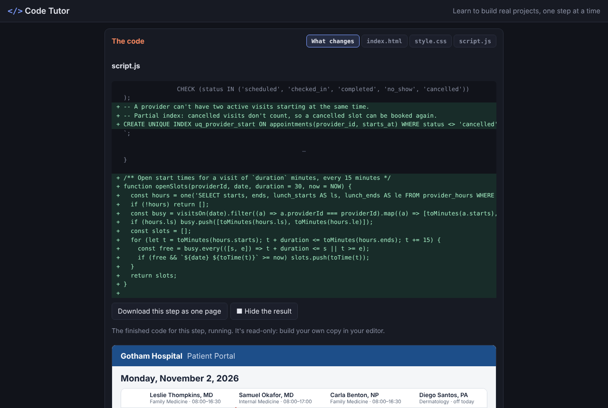
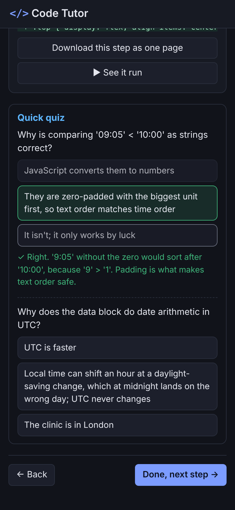

# CodeForge

**▶ [Open CodeForge](https://theoyanvno.github.io/CodeForge/)** · **[Start the Snake guide](https://theoyanvno.github.io/CodeForge/?guide=snake)**

Step-by-step guides that teach you to build my portfolio projects from a blank page. Pick a project and follow its lesson plan: each step explains one idea with diagrams and tables, shows exactly which lines of code the step adds and why, lets you see the finished step run, and ends with a short quiz. A pace timer keeps you on schedule, and your progress is saved in the browser.

It's a learning guide, not a code playground: you build your own copy in your own editor (VS Code, for example), typing each step's changes yourself. Fell behind? Copy a whole file, or download the step as one page.

**Tech:** vanilla JavaScript (ES modules) · HTML/CSS · a small safe Markdown renderer · LCS line diffs · sandboxed `<iframe srcdoc>` for the read-only results · `localStorage` · `node:test`





## The guides

| Guide | Steps | What you learn |
|---|---|---|
| 🐍 [Snake](https://github.com/TheoYanvno/snake-game) | 13 in 4 sessions · about 3 h · 26 quiz questions | Canvas drawing, a game loop, keyboard and swipe controls, keeping rules separate from drawing |
| 🔢 [Sudoku Solver](https://github.com/TheoYanvno/sudoku-solver) | 12 in 5 sessions · about 3 h · 22 quiz questions | Bitmasks, constraint propagation, recursion and backtracking, generating puzzles with one answer |
| ♟️ [Chess Coach](https://github.com/TheoYanvno/chess-coach) | 13 in 5 sessions · about 3.5 h · 24 quiz questions | Legal move generation, evaluation, negamax with alpha-beta pruning, grading moves and explaining them |
| 🗒️ [Sticky Notes](https://github.com/TheoYanvno/sticky-notes) | 11 in 5 sessions · about 3 h · 20 quiz questions | State as plain objects, a reversible checklist, keeping focus across redraws, pointer-event dragging, safe saving |
| 📅 [Task Calendar](https://github.com/TheoYanvno/task-calendar) | 11 in 5 sessions · about 3 h · 20 quiz questions | Date keys without time-zone bugs, repeat rules, holiday math, theming with custom properties, .ics and Google Calendar links |
| 💬 [Quote & Joke Generator](https://github.com/TheoYanvno/quote-and-joke-generator) | 10 in 5 sessions · about 3 h · 18 quiz questions | Random picks without repeats, a date-seeded daily pick, salted password hashing, sessions and lockouts, a REST API as one function |
| 🔥 [Bonfire Notes](https://github.com/TheoYanvno/bonfire-notes) | 10 in 5 sessions · about 3 h · 18 quiz questions | Front matter, a safe Markdown converter, hash routing, RSS and redirects, canvas particles |
| 🦸 [Marvel Character Database](https://github.com/TheoYanvno/marvel-character-database) | 11 in 5 sessions · about 3 h · 20 quiz questions | Related tables and link tables, parameterized SQL, ranked search, GROUP BY and HAVING, UNION across both sides of a relationship, SQLite in the browser |
| 📖 [SuperBook](https://github.com/TheoYanvno/SuperBook) | 10 in 5 sessions · about 3 h · 18 quiz questions | Fetching from three public APIs, caching and late responses, question matching with stemming and weighted keywords, writing on a canvas, right-to-left languages |
| 🏥 [Gotham Hospital System](https://github.com/TheoYanvno/gotham-hospital-system) | 10 in 5 sessions · about 4.5 h · 17 quiz questions | A day schedule as a table, SQLite keys and CHECK constraints, booking rules and the overlap test, a partial unique index, upserts and reports, salted PBKDF2 sign-in, sessions, and 401/403 role permissions |

A new guide is added for each of my projects, easiest first: Quote & Joke Generator, Task Calendar, Sudoku Solver, Sticky Notes, Bonfire Notes, Marvel Character Database, Chess Coach, SuperBook, Gotham Hospital System, Blueit and Cybersecurity Intro Academy. Each guide is written against the project as it is in its repo today.

## How a guide works

- **Lesson plan:** every guide opens with its goals, what you should know first, how to follow along, and its sessions: groups of steps for one sitting, each ending with a working project, with the planned minutes for every step.
- **Each step** explains one idea with examples, diagrams and tables, and lists what you write in it.
- **The code:** *What changes* shows the step as a diff (added lines in green, removed lines struck through). The `index.html`, `style.css` and `script.js` tabs show each whole file after the step, with a **Copy** button. **Download this step as one page** saves the finished step as a single HTML file.
- **See it run** shows the finished step working, read-only, in a sandboxed frame.
- **Quick quiz:** multiple-choice questions on the idea behind the code, with an explanation for each answer. Only your first answer counts.
- **Pace timer:** ⏱ counts your time on a step (only while the page is visible) against its planned time.
- **Progress:** your place, the steps you've finished, your time per step and your quiz answers are saved in your browser. The finish page shows steps done, your quiz score and your time against the plan, and **Reset this guide** starts it over.
- **Read-along steps** at the end of each guide show how the real project is organized, with its tests.

Guides are written in Markdown ([`guides/`](guides/), format in [`guides/README.md`](guides/README.md)) and built into the modules in `src/lessons/` by [`scripts/build-guides.js`](scripts/build-guides.js). The tests check that every step's code really contains what the step says you write (and didn't before it), and that every guide is a full lesson: goals, sessions of five steps or fewer, a planned time and a quiz for every step, and at least three diagrams.

## How it works

**Building each step's code** ([`src/tutor-core.js`](src/tutor-core.js)). A guide's code is a list of named blocks per file (for example the snake's `rules`, `draw` and `controls`). Each step replaces or adds blocks, and `assemble()` builds the full code after every step, so a step's starting code and its finished code are always exact. *What changes* is a longest-common-subsequence line diff between the two, trimmed to the changed lines with a little context.

**Safe guide content.** The explanations use a small Markdown renderer that escapes everything first and only allows `https:` links, so a guide can't inject HTML. Diagrams are SVG shown through an `` with a `data:` URL, so nothing inside them can run.

**See it run** ([`src/preview.js`](src/preview.js)). The step's HTML, CSS and JavaScript are put together into one page (a `</script>` inside the JavaScript is escaped as `<\/script>`, which means the same in JavaScript) and shown in an `<iframe>` with `sandbox="allow-scripts"` and *without* `allow-same-origin`, so it runs in its own origin and can't read the tutor's saved progress. The same page is what **Download** saves.

**Progress, pace and quizzes.** `Progress` keeps each guide's place, finished steps, seconds per step and quiz answers in `localStorage`, with every read and write wrapped in `try/catch` because storage can be blocked in private windows. `lessonPlan()`, `pace()` and `gradeQuiz()` are plain functions, tested in Node like the rest.

## Run it

No install needed. Serve the folder (ES modules don't load from `file://`):

```bash
npm start      # python3 -m http.server 8000, then open http://localhost:8000
npm test       # node --test (Node 18+)
npm run guides # rebuild src/lessons/ after editing a guide in guides/
```

| File | What it does |
|---|---|
| `src/app.js` | Starts the tutor |
| `src/tutor.js` | The pages: guide list, lesson plan, steps with their code, See it run, download, quizzes, pace timer and progress |
| `src/tutor-core.js` | Building each step's code, Markdown with diagrams and tables, line diff, the step checks the tests use, lesson plan, pace, quiz grading and progress (no DOM, tested in Node) |
| `src/preview.js` | Puts a step's HTML, CSS and JavaScript together into one page |
| `src/lessons/` | The built guides, plus the guide list in `index.js` |
| `guides/` | The guides in Markdown |
| `scripts/build-guides.js` | Turns the Markdown guides into `src/lessons/` modules |

Built with help from AI coding tools for planning, code review and tests.
